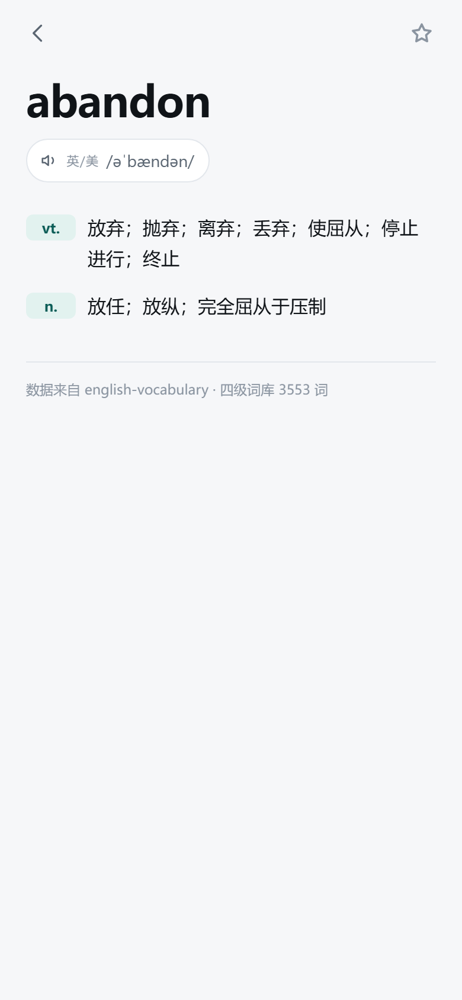

# 四级词汇 · 随手查

大学英语四级词汇的离线查词 PWA。纯静态、零依赖、零构建，手机浏览器打开即可用，加到主屏幕后跟 App 一样。

<p>
  
  
</p>

## 功能

- **3553 个四级词条**：合并《四级词汇乱序便携版》与《星火四级词汇必背乱序版》，去重后 3553 词
- **英式 / 美式双音标**，点一下就能读（默认走系统 TTS，可切换在线真人发音）
- **搜索**：前缀 → 包含 → 拼写容错（`recieve` 也能查到 receive）；中文意思也能反查（输入「放弃」出 abandon）
- **生词本**：星标收藏，存在本机浏览器里，可导出 CSV 丢进 Anki
- **最近查询** 与 **随机一词**
- **深色 / 浅色 / 跟随系统**
- **完全离线**：首屏索引 68KB，词库装进 Service Worker，断网照样查

## 手机上用

### 1. 先在本机预览

```bash
node scripts/dev-server.mjs
```

终端会打印两个地址：

- `http://localhost:4173` —— 电脑上看
- `http://192.168.x.x:4173` —— 手机连同一个 WiFi 就能打开

> 局域网是 http，Service Worker 不会生效（浏览器限制），能查词但没有离线能力；部署到 https 之后离线才完整。

### 2. 加到主屏幕

- **iPhone / Safari**：分享 → 「添加到主屏幕」
- **Android / Chrome**：菜单 → 「安装应用」或「添加到主屏幕」

之后从桌面图标进入就是全屏、无地址栏的独立窗口。

## 部署到 GitHub Pages

仓库根目录就是发布目录，推上去开一下 Pages 即可。

```bash
git init
git add .
git commit -m "feat: 四级词汇查询"
git branch -M main
git remote add origin https://github.com/<你的账号>/<仓库名>.git
git push -u origin main
```

然后到 GitHub 仓库 → **Settings → Pages** → Source 选 **Deploy from a branch** → 分支 `main`、目录 `/ (root)` → Save。

一两分钟后访问：`https://<你的账号>.github.io/<仓库名>/`

> 之后每次改完代码 `git push`，Pages 会自动重新发布。改了词库记得同时把 `sw.js` 里的 `VERSION` 加一，否则老用户会一直用缓存里的旧词库。

## 部署到 Vercel / Netlify（不想建仓库时）

```bash
node scripts/pack.mjs
```

会生成一个干净的 `dist/`（约 0.58 MB）：

- **Vercel**：新建项目 → 上传 `dist` 目录，或 GitHub 导入仓库后 Framework 选 Other、Build Command 留空、Output Directory 填 `.`
- **Netlify Drop**：把 `dist` 文件夹直接拖到 <https://app.netlify.com/drop>

## 目录结构

```
index.html              单页外壳
assets/style.css        全部样式（含深色模式）
assets/search.js        搜索算法（纯函数，可单测）
assets/app.js           交互逻辑
data/index.json         首屏索引：单词 + 音标 + 首义（68KB gzip）
data/d/<字母>.json      按首字母切开的完整释义，点开词条时才加载
sw.js                   离线缓存
manifest.webmanifest    PWA 清单
icons/                  图标（由 scripts/make-icons.ps1 生成）
scripts/                数据管道、本地服务、测试、打包
```

没有打包步骤：浏览器直接跑 ES Module，改完刷新就见效。

## 词库与数据重建

词表来自开源项目 [english-vocabulary](https://gitee.com/staryihui/english-vocabulary)（10 万词条词库，含双音标、中文释义、词频）。

```bash
# 1. 拉原始数据（约 100MB，只做一次）
git -c http.sslBackend=openssl clone --depth 1 https://gitee.com/staryihui/english-vocabulary.git data/repo

# 2. 生成 data/index.json 与 data/d/*.json
node scripts/build-data.mjs
```

脚本逻辑在 `scripts/build-data.mjs`：按 `bookid ∈ {1, 3}` 取四级词书 → 关联词条 → 清洗释义 → 去重排序 → 切分。

> Windows 上如果 `git clone` 报 `schannel: AcquireCredentialsHandle failed`，就是上面那条命令里 `-c http.sslBackend=openssl` 的作用。

## 开发与测试

```bash
node scripts/test-search.mjs    # 搜索算法 + 数据完整性自测（21 项）
node scripts/e2e.mjs            # 用本机 Chrome 在 390×844 手机尺寸下跑一遍界面，出截图（19 项）
node scripts/pack.mjs           # 生成可部署的 dist/
```

`e2e.mjs` 走 Chrome DevTools Protocol，覆盖：首页渲染、搜索、详情、收藏、返回、中文反查、设置面板、深色模式、断网后仍可查询。

## 已知限制

- **发音**依赖系统的语音包。iOS 和多数安卓机自带英文语音；个别机型没装英文语音时会没声音，此时可以切到「在线真人」（走第三方公开接口，可能失效，失败会自动回退系统语音）。
- **词表覆盖**是两本四级词书合并的结果（3553 词），略小于官方大纲的 4500 词——大纲里那些 `a / the / of` 之类的基础词没有收进来。
- **数据版权**：词库取自上述开源仓库，仓库本身未声明许可证，这里只作个人学习查询使用，请勿商用。代码部分随便用。
- 生词本存在浏览器 localStorage 里，**换手机或清缓存会丢**，重要的话记得先导出 CSV。

## 后续可以加

- 拼写 / 选择题测验，错词自动进生词本
- 例句（原数据集里有 14 万条中英对照例句，接回来只是数据体积问题）
- 按 SM-2 的复习提醒
- 词根词缀、近义词
